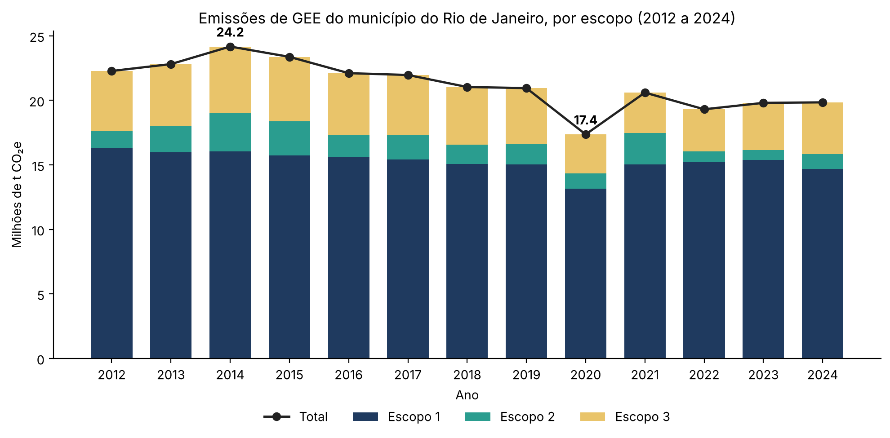

# Emissões de Gases de Efeito Estufa (GEE) na Cidade do Rio de Janeiro, 2012 a 2024


| | |
|---|---|
| **Autores** | Cassiano Siqueira · André de Moraes |
| **Orientador(a)** | _[NOME COMPLETO DO PROFESSOR ORIENTADOR]_ |
| **Instituição / Curso** | Unilasalle RJ, Bacharelado em Sistemas de Informação (6º período) |
| **Disciplina** | Linguagem de Programação (Análise e Visualização de Dados com Python) |
| **Semestre** | _[2026.2, confirmar]_ |
| **Artigo (GitHub Pages)** | <https://cassiano-siqueira.github.io/gases-efeito-estufa/> |

**Palavras-chave:** gases de efeito estufa · inventário de emissões · Rio de Janeiro · dados abertos · Python · princípios FAIR

---

## Resumo executivo

Este projeto analisa o inventário de emissões de gases de efeito estufa da cidade do Rio de Janeiro entre 2012 e 2024, publicado pelo Instituto Municipal de Urbanismo Pereira Passos (IPP) no portal Data.Rio segundo a metodologia GPC. Um pipeline reprodutível em Python converte a planilha original (cabeçalho em dois níveis, linhas hierárquicas) em uma tabela longa, preserva a hierarquia de setores, **distingue zero de dado ausente** e valida os totais. Três perguntas de pesquisa orientam a análise:

| # | Pergunta | Principal achado |
|---|----------|------------------|
| **RQ1** | Como o total de emissões evoluiu entre 2012 e 2024? | Queda de **10,9%** (22,3 → 19,8 Mt CO₂e), com mínimo em 2020 (17,4 Mt) |
| **RQ2** | Quais setores são os principais ofensores de emissões diretas (Escopo 1)? | **Energia Estacionária (52,9%)** e **Transportes (31,1%)** concentram 84% do Escopo 1 em 2024 |
| **RQ3** | Qual a participação de Residencial e Comercial no Escopo 2? | Somam **55% a 63%** do Escopo 2, em séries quase perfeitamente correlacionadas (r ≈ 0,99) |

> **Achado metodológico:** a tabela é hierárquica (macrossetores contêm subsetores). Somar todas as linhas **duplica** as emissões (razão exata de 2,00). Os totais deste projeto vêm da linha `TOTAL` oficial da fonte.

**Leia o artigo completo, com gráficos interativos:** [`docs/index.html`](docs/index.html)



---

## Fonte dos dados

- **Dados brutos:** Tabela 3696: *Emissões de gases de efeito estufa (GEE) da Cidade do Rio de Janeiro por escopo segundo metodologia GPC, em t CO₂e, 2012 a 2024*. Instituto Municipal de Urbanismo Pereira Passos (IPP), Prefeitura do Rio de Janeiro, via portal **Data.Rio**: <https://www.data.rio> _[inserir aqui o link permanente da página do conjunto de dados]_.
- **Relatório metodológico do IPP:** [Monitoramento das emissões de GEE da cidade do Rio de Janeiro, 2012 a 2021](https://ambienteclima.prefeitura.rio/wp-content/uploads/sites/81/2023/12/InventarioGEE2020_2021.pdf).
- **Cópia utilizada:** [`data/raw/3696.xls`](data/raw/3696.xls) (aba `3696_Escopos`).

---

## Estrutura do repositório

```
gases-efeito-estufa/
├── README.md
├── LICENSE                        # MIT (código)
├── LICENSE-DATA.md                # CC BY 4.0 (dados derivados e texto)
├── requirements.txt               # dependências com versões fixadas
├── .gitignore
├── data/
│   ├── raw/3696.xls               # planilha original (Data.Rio/IPP)
│   ├── processed/
│   │   └── emissoes_gee_rj_limpo.csv.gz   # dados limpos (formato longo)
│   └── data_dictionary.md         # dicionário de dados
├── notebooks/
│   └── analise_exploratoria.ipynb # EDA (RQ1 a RQ3), com saídas
├── src/
│   ├── __init__.py
│   ├── etl.py                     # extração, transformação e validação
│   └── metricas.py                # agregações, métricas e figuras
└── docs/                          # artigo publicado via GitHub Pages
    ├── index.html
    └── assets/                    # figuras (.png) e dados dos gráficos (.json/.js)
```

---

## Como reproduzir

**Pré-requisitos:** Python 3.11+ e Git. Nenhuma credencial é necessária.

```bash
# 1. Clonar o repositório
git clone https://github.com/Cassiano-Siqueira/gases-efeito-estufa.git
cd gases-efeito-estufa

# 2. Criar e ativar o ambiente virtual
python -m venv .venv
source .venv/bin/activate        # Windows (PowerShell): .venv\Scripts\Activate.ps1

# 3. Instalar as dependências (versões fixadas)
pip install -r requirements.txt

# 4. Executar o ETL  ->  data/processed/emissoes_gee_rj_limpo.csv.gz
python src/etl.py

# 5. Abrir o notebook (gera as figuras em docs/assets/)
pip install notebook             # ou use o VS Code / JupyterLab
jupyter notebook notebooks/analise_exploratoria.ipynb
```

Para ler o artigo localmente, abra `docs/index.html` no navegador (os gráficos interativos carregam o Plotly.js via CDN e precisam de internet).

### Esquema do dado processado

| Coluna | Tipo | Descrição |
|--------|------|-----------|
| `ano` | inteiro | 2012 a 2024 |
| `macrossetor` | texto | Categoria de 1º nível do GPC (vazio para o total) |
| `setor` | texto | Setor ou subsetor emissor |
| `nivel` | texto | `total`, `macrossetor`, `subsetor` ou `item_informativo` |
| `escopo` | texto | `Escopo 1`, `Escopo 2`, `Escopo 3` ou `Total` |
| `emissao_tCO2e` | decimal | Emissão em toneladas de CO₂ equivalente (pode ser negativa = remoção, ou vazia) |
| `qualidade_dado` | texto | `valor`, `zero`, `nao_disponivel`, `nao_estimado` |

Detalhes completos, domínios e tratamentos aplicados: [`data/data_dictionary.md`](data/data_dictionary.md).

---

## Pipeline de dados (`src/etl.py`)

1. Lê a aba `3696_Escopos` e localiza o cabeçalho pela célula `Nome` (sem posições fixas).
2. Propaga os anos das células mescladas (*forward fill*) e converte de *wide* para *long*.
3. Classifica cada linha na hierarquia (`nivel`, `macrossetor`).
4. Converte os símbolos da fonte **sem imputar valores**: `-` → zero; `...` e `NE` → ausente (`NaN`), registrando a origem em `qualidade_dado`.
5. Remove notas de rodapé, limpa rótulos e corrige dois erros de digitação da fonte.
6. **Valida** que a soma dos macrossetores reproduz o `TOTAL` oficial (tolerância de 0,5%).
7. Salva em CSV compactado (`.csv.gz`).

---

## Limitações

- Os valores são **estimativas de inventário**; segundo a fonte, os anos de 2012 a 2021 foram **revisados em 2024**.
- A base não contém variáveis explicativas (PIB, clima, fatores de emissão); as interpretações causais do artigo são **hipóteses**.
- O símbolo `NE` não consta nas notas da fonte; foi interpretado como "não estimado".
- Apenas a aba por escopo é analisada (a aba por gás (CO₂, CH₄, N₂O) não foi explorada).

## Trabalhos futuros

Cruzar as emissões com PIB e população do município · incorporar fatores de emissão da rede elétrica (hipótese da RQ3) · analisar a decomposição por gás · automatizar o download dos dados.

---

## Declaração FAIR

| Princípio | Como é atendido |
|-----------|-----------------|
| **Findable** | README completo, palavras-chave, autoria, disciplina, instituição e link da fonte |
| **Accessible** | Repositório público; scripts sem autenticação; artigo no GitHub Pages, responsivo |
| **Interoperable** | Dados em CSV compactado (`.csv.gz`) e dicionário de dados em Markdown |
| **Reusable** | Licenças MIT (código) e CC BY 4.0 (dados derivados e texto); `requirements.txt` com versões fixadas |

---

## Referências

- HUNTER, J. D. Matplotlib: a 2D graphics environment. *Computing in Science & Engineering*, v. 9, n. 3, p. 90-95, 2007.
- INSTITUTO MUNICIPAL DE URBANISMO PEREIRA PASSOS (IPP). *Emissões de gases de efeito estufa (GEE) da Cidade do Rio de Janeiro por escopo segundo metodologia GPC, 2012 a 2024* (Tabela 3696). Data.Rio. Disponível em: <https://www.data.rio>.
- INTERGOVERNMENTAL PANEL ON CLIMATE CHANGE (IPCC). *Climate Change 2014: Synthesis Report*. Geneva: IPCC, 2014.
- MCKINNEY, W. Data structures for statistical computing in Python. In: PYTHON IN SCIENCE CONFERENCE, 9., 2010. *Proceedings*. Austin: SciPy, 2010. p. 56-61.
- WILKINSON, M. D. et al. The FAIR Guiding Principles for scientific data management and stewardship. *Scientific Data*, v. 3, art. 160018, 2016.
- WRI; C40; ICLEI. *Global Protocol for Community-Scale Greenhouse Gas Emission Inventories (GPC)*, versão 1.1, 2014.

---

## Licenças

- **Código** (`src/`, `notebooks/`): [MIT](LICENSE).
- **Dados derivados, dicionário, figuras e texto** (`data/processed/`, `data/data_dictionary.md`, `docs/`): [CC BY 4.0](LICENSE-DATA.md).
- **Dados originais** (`data/raw/`): termos de uso do Data.Rio/IPP.
